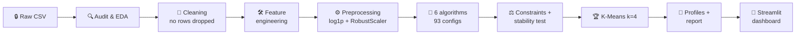
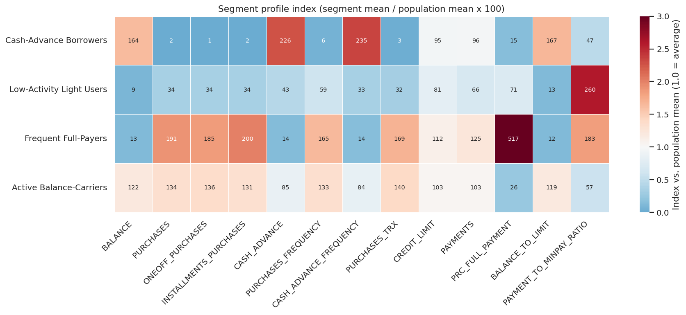
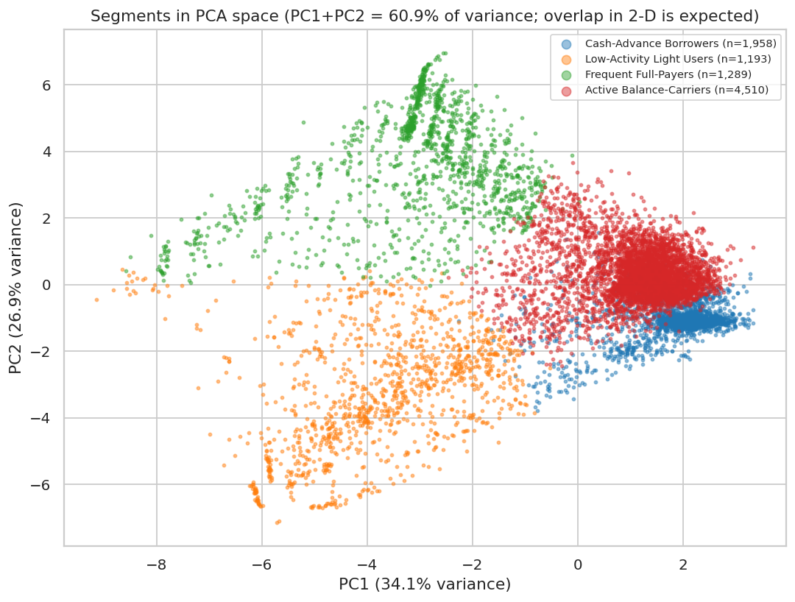
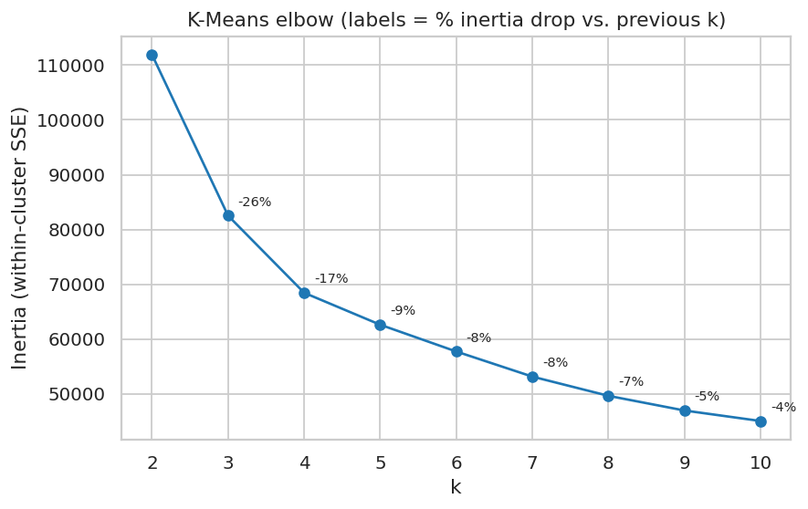
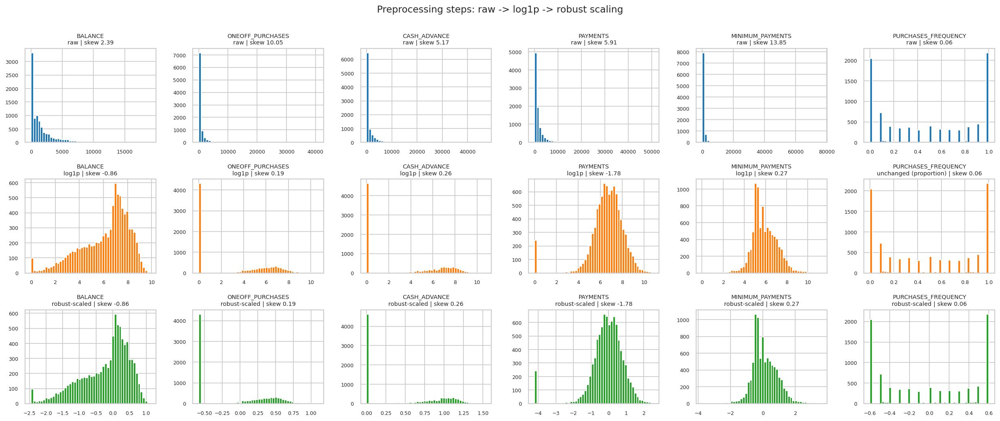
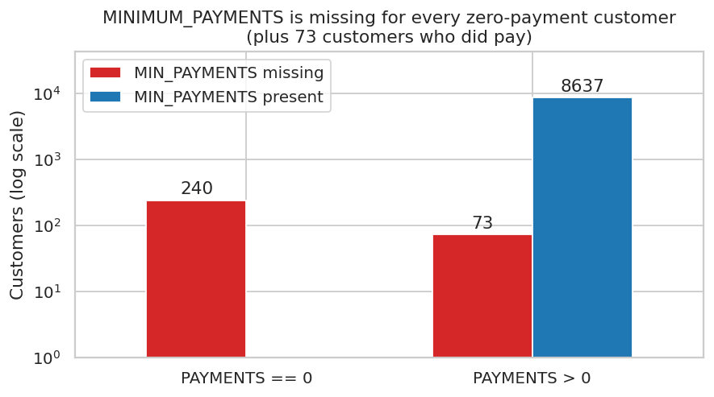
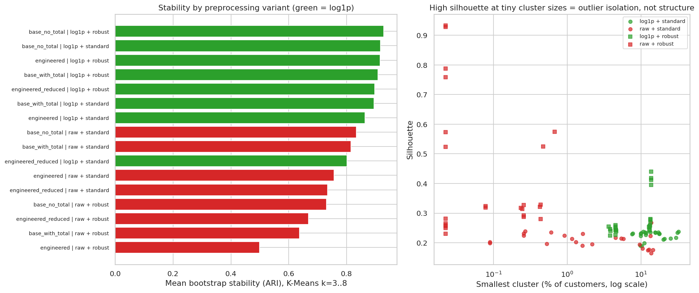

<div align="center">

# 💳 Credit-Card Customer Segmentation

**An end-to-end, reproducible machine-learning project: from a raw CSV to four evidence-based customer segments, a full report, and a deployed Streamlit dashboard.**

`Python 3.12` · `scikit-learn 1.8` · `pandas 3` · `Streamlit 1.65` · `78 tests passing`

### 🚀 [**Try the live app →**](https://customer-segmentation-mxv9ppwxfevahrpmyvnesu.streamlit.app/)

[](https://customer-segmentation-mxv9ppwxfevahrpmyvnesu.streamlit.app/)

</div>

---

## 🧭 Table of contents

1. [TL;DR - the results at a glance](#-tldr---the-results-at-a-glance)
2. [🌐 Try it live](#-try-it-live)
3. [Objective and dataset](#-objective-and-dataset)
4. [How the project works](#-how-the-project-works)
5. [What was done, phase by phase](#-what-was-done-phase-by-phase)
6. [Key decisions and the evidence behind them](#-key-decisions-and-the-evidence-behind-them)
7. [What happened to the outliers?](#-what-happened-to-the-outliers)
8. [Algorithms compared](#-algorithms-compared)
9. [The final model and why](#-the-final-model-and-why)
10. [The four customer segments](#-the-four-customer-segments)
11. [Visual gallery](#-visual-gallery)
12. [The dashboard](#-the-dashboard)
13. [Quick start (run locally)](#-quick-start)
14. [Deployment](#-deployment)
15. [Project structure and outputs](#-project-structure-and-outputs)
16. [Verification: what was actually executed](#-verification-what-was-actually-executed)
17. [Limitations and honest caveats](#-limitations-and-honest-caveats)
18. [Ideas for next steps](#-ideas-for-next-steps)


---

## 🎯 TL;DR - the results at a glance

| | |
|---|---|
| 🧑‍🤝‍🧑 **Customers analysed** | **8,950** (none removed) |
| 🏆 **Selected model** | **K-Means, k = 4**, on 19 features after `log1p` + `RobustScaler` |
| 📊 **Quality** | Silhouette **0.277** · Davies-Bouldin **1.18** · Calinski-Harabasz **3,695** |
| 🔁 **Stability** | **ARI 0.993 ± 0.003** over 10 pairs of independent 80% subsamples |
| 📏 **Smallest segment** | **13.3%** of customers (no tiny or outlier-only segments) |
| 🧪 **Models tried** | **93 configurations** across 6 algorithms; 42 passed the hard business constraints |
| 🌐 **Live app** | **[customer-segmentation …streamlit.app](https://customer-segmentation-mxv9ppwxfevahrpmyvnesu.streamlit.app/)** |
| ✅ **Tests** | **78 passed**, including "scoring all 8,950 raw customers reproduces the saved assignments exactly" |

**The four segments** (observed behaviour, medians):

| Segment | Share | In one line |
|---|---|---|
| 🛒 **Active Balance-Carriers** | 50.4% | Buy often (purchase freq. 0.75), carry a balance (utilisation 0.41), no one pays in full ≥50% of the time |
| 💵 **Cash-Advance Borrowers** | 21.9% | 90.6% made no purchases; median cash advance 1,366; utilisation 0.70 |
| 🌿 **Frequent Full-Payers** | 14.4% | Buy almost every period (0.92), 90.9% pay in full ≥50% of the time, utilisation 0.02 |
| 💤 **Low-Activity Light Users** | 13.3% | Median balance just 23, purchase freq. 0.17, utilisation 0.01 |

> ⚠️ **Honesty box.** The dataset has **no revenue, interest, fee or default data**. Anything said about *profitability* or *risk* below is an **assumption to test**, never a finding. Also, k = 4 was a **documented judgement call** that overrode the top-ranked k = 3 (see [why](#-the-final-model-and-why)).

---

## 🌐 Try it live

**👉 [https://customer-segmentation-mxv9ppwxfevahrpmyvnesu.streamlit.app/](https://customer-segmentation-mxv9ppwxfevahrpmyvnesu.streamlit.app/)**

> 💤 Free Streamlit apps go to sleep when idle. If you see a "this app has gone to sleep" page, click the button to wake it and wait a minute.

### ⏱️ A 2-minute test tour

| Step | Where | What to do | What you should see |
|---|---|---|---|
| 1 | 🏠 **Overview** | Look at the segment sizes and the PCA plot | Four segments: 4,510 / 1,958 / 1,289 / 1,193 customers |
| 2 | 🧪 **Test the model** | Pick the preset **Cash-Advance Borrowers**, press **Assign segment** | *Cash-Advance Borrowers* (margin ≈ 0.85) |
| 3 | 🧪 **Test the model** | Repeat with **Frequent Full-Payers**, **Low-Activity Light Users**, **Active Balance-Carriers** | Each lands in its own segment (margins ≈ 0.75 / 0.65 / 0.71) |
| 4 | 🧪 **Test the model** | Start from the *Cash-Advance* preset, then set `PURCHASES_TRX` = 40 and `PRC_FULL_PAYMENT` = 1 | The assignment should move toward a purchasing segment |
| 5 | 🧪 **Test the model** | Enter a `BALANCE` far above 19,043 (the largest in the data) | A warning that the result is an extrapolation |
| 6 | 🔎 **Customer lookup** | Enter `C10001` | Its segment, compared with the segment median |
| 7 | 🔍 **EDA** / ⚙️ **Preprocessing** | Scroll through the figures | 9 EDA figures; the transform steps and 16-variant comparison |
| 8 | 🧪 **Test the model → Batch** | Download the CSV template, edit it, upload it, download the scored file | A scored CSV with segment, distances and margin |

The margins above come from running the same saved model locally; the live app should match them.

> 🔐 **Please don't upload real customer data** to the public app: the batch upload sends your file to the hosting server. Use the template with made-up values.

---

## 📌 Objective and dataset

**Goal:** group credit-card customers by *how they actually use their card*, so marketing and product teams can treat different behaviours differently.

**Data:** `data/raw/Customer-Data - 2.csv` - **8,950 customers × 18 columns**: `CUST_ID` plus 17 numeric fields (balance, purchases and their one-off/instalment split, cash advance, purchase/cash frequencies, transaction counts, credit limit, payments, minimum payments, share of full payments, tenure).

🔒 The raw file is **never modified**: it is read-only, its SHA-256 is stored in `data/raw/SHA256SUM.txt`, and every pipeline run re-checks it.

---

## 🧩 How the project works



---

## ✅ What was done, phase by phase

| # | Phase | What was done | Key output |
|---|---|---|---|
| 1 | 🔍 **Audit & EDA** | Schema, nulls, duplicates, invalid values, correlations, skew, outliers, logical consistency | `outputs/data_audit_*.csv`, 9 EDA figures |
| 2 | 🧹 **Cleaning** | Clip 8 invalid frequencies; flag then impute missing values; **keep every row** | `outputs/cleaning_log.json` |
| 3 | 🛠️ **Features** | Utilisation, payment-vs-minimum, one-off share, average ticket (guarded divisions) | `src/segmentation/features.py` |
| 4 | ⚙️ **Preprocessing** | scikit-learn `Pipeline`; **16 variants** compared (4 feature sets × log/no-log × 2 scalers) | `outputs/preprocessing_comparison.csv` |
| 5 | 🧪 **Clustering** | K-Means, MiniBatch K-Means, Agglomerative, GMM, DBSCAN, HDBSCAN; fixed seeds | `outputs/clustering_grid_all_models.csv` |
| 6 | ⚖️ **Selection** | Hard constraints → finalists → bootstrap stability → composite rank → documented decision | `outputs/model_comparison.csv` |
| 7 | 👥 **Profiling** | Segment medians, repayment behaviour, rule-based names, suggestions | `outputs/segment_summary.csv` |
| 8 | 📈 **Reporting** | 24 figures + a generated report (every number read from output files) | `reports/final_report.md` |
| 9 | 📱 **Dashboard** | 9-tab Streamlit app with a "Test the model" scoring form | `app/streamlit_app.py` |
| 10 | 🧱 **Engineering** | Modular package, YAML config, logging, docstrings, error handling, unit tests | `src/`, `tests/`, `configs/` |

---

## 🧠 Key decisions and the evidence behind them

| Decision | Choice | 📊 Evidence |
|---|---|---|
| **Missing `MINIMUM_PAYMENTS`** (313 rows) | Add a flag, then fill with the median (312.3) | All 240 zero-payment customers have it missing, plus 73 who did pay: *not* random. Refitting with zero-fill or balance-scaled fill gives **ARI 0.990 / 0.994** vs the median → the choice barely matters |
| **Missing `CREDIT_LIMIT`** (1 row) | Median (3,000) | Single value; negligible |
| **Invalid `CASH_ADVANCE_FREQUENCY` > 1** (8 rows) | Clip to 1, logged | A frequency cannot exceed 1 |
| **`PURCHASES` column** | Excluded from the model | Equals `ONEOFF + INSTALLMENTS` in **99.78%** of rows → would double-count purchase behaviour |
| **Skewed amounts** | `log1p` on 12 non-negative, unbounded, skewed columns | Without it, K-Means isolates clusters of **~2 customers**; log variants are the most stable. Absolute skew fell for all 12 columns |
| **Scaling** | `RobustScaler` | Better silhouette and Davies-Bouldin than `StandardScaler` at every k, highest stability |
| **`TENURE`** | Profiled, not clustered | 85% of customers sit at 12; it describes the window, not behaviour |
| **Engineered features** | Included | A *statistical tie* with the base set on metrics; kept for utilisation and repayment-vs-minimum signal (see caveat below) |
| **Highly correlated pairs** (e.g. cash-advance count vs frequency, r = 0.92) | Reported, **not** removed | Removing the two `*_TRX` columns did not improve stability |

> 🔎 **Caveat on the feature-set choice:** metrics tied, but re-clustering on the base feature set agrees with the final labels only at **ARI 0.64**. Trust the segment *archetypes* more than any single customer's label.

---

## 🚨 What happened to the outliers?

**Nothing was deleted.** The cleaning code asserts the row count never changes.

The extreme customers looked real, not like errors: for example the biggest purchaser has ~49k in purchases, 101 transactions, a 22.5k limit and ~47k in payments, all consistent. 227 customers have a balance above their limit, which is plausible for over-limit accounts.

What we did instead:
1. 📉 `log1p` pulls the long tails in.
2. 🧮 `RobustScaler` scales by median/IQR, so extremes don't distort the scale.
3. 🔬 Variants that let outliers dominate were **rejected on evidence** (raw-scale runs produced 2-customer clusters).
4. 🚫 Models that isolated outliers (average linkage with a 1-customer cluster) were **disqualified** by the "smallest cluster ≥ 2%" rule.

⚠️ *Not done:* a test refitting without the top 1% of extreme customers to measure how much the segments move.

---

## 🧪 Algorithms compared

**93 candidates**, all with fixed seeds. Hard constraints: **3-8 clusters, smallest cluster ≥ 2%, noise ≤ 20%**. Finalists then got a subsample stability test.

| Algorithm | Configs tried | Passed constraints | What happened |
|---|---|---|---|
| ⭐ **K-Means** | 9 | 6 | The most stable family (ARI up to 0.995) |
| MiniBatch K-Means | 9 | 6 | Good scores but **unstable** on subsamples (ARI 0.64-0.91) |
| Agglomerative (ward, average) | 18 | 6 | Ward is decent but less stable (0.76-0.82); **average linkage isolates single customers** |
| Gaussian Mixture | 36 | 24 | Spherical is competitive; tied k=3 rejected as unstable (ARI 0.55); full covariance has silhouettes of only 0.03-0.15 |
| DBSCAN | 15 | **0** | Collapses to one cluster, or one dominant cluster plus slivers |
| HDBSCAN | 6 | **0** | Labels 10-52% of customers as noise |

> 💡 **Lesson:** the highest silhouettes in the grid (0.43-0.47) came from DBSCAN/HDBSCAN models that **failed the business constraints** (only 2-3 clusters, with slivers of 0.6-1.5% of customers), and in the preprocessing study from raw-scale runs with 2-customer clusters. That is exactly why selection never relied on one score.

---

## 🏆 The final model and why

**K-Means with k = 4** (`n_init = 10`, seed 42).

| Finalist | Silhouette | Davies-Bouldin | Calinski-Harabasz | Stability (ARI) | Composite rank |
|---|---|---|---|---|---|
| K-Means k=3 | 0.396 | 1.035 | 3,833 | 0.995 | **1.25** (rank winner) |
| ✅ **K-Means k=4** | 0.277 | 1.184 | 3,695 | 0.993 | 4.50 (**selected**) |
| GMM spherical k=4 | 0.263 | 1.157 | 3,468 | 0.995 | 4.75 |
| K-Means k=5 | 0.253 | 1.403 | 3,237 | 0.877 ± 0.13 | 8.25 |

### Why k = 4 instead of the rank winner k = 3?
The composite rank is biased toward small k (silhouette and CH fall as k grows). Looking at the actual customers:

- k = 3's biggest segment (**71%** of customers) mixes **cash-advance borrowers** with **active purchasers**, two opposite behaviours.
- k = 4 splits exactly that group, leaves the other two segments almost unchanged, sits at the **inertia elbow** (drops of 26% for k 2→3, 17% for 3→4, then 9% or less), and is just as stable.
- k = 5 splits an already-coherent segment and becomes less stable.

⚠️ **This was a judgement call made after reviewing the profiles**, not pre-registered. To use k = 3, change `selection.final_model_id` in `configs/config.yaml` and re-run.

### Is it "good"?
It is **good enough to use, not a clean natural clustering.** A silhouette of 0.277 means moderate overlap, and density-based methods found no separated groups. Treat the segments as **useful partitions of a continuum**; customers near boundaries could reasonably sit in a neighbouring segment.

**About PCA:** the 2-D plot shows only **60.9%** of the variance (4 components are needed for 80%, 7 for 90%). Clustering used **all 19 features**; PCA is only for the picture.

---

## 👥 The four customer segments

Observed behaviour (cleaned original-scale **medians**):

| Segment | Customers | Balance | Purchases | Purchase freq. | Cash advance | Credit limit | Payments | Utilisation | Pay in full ≥50% | No purchases |
|---|---|---|---|---|---|---|---|---|---|---|
| 💵 Cash-Advance Borrowers | 1,958 (21.9%) | 1,754 | 0 | 0.00 | 1,366 | 3,000 | 820 | 0.70 | 0.2% | 90.6% |
| 💤 Low-Activity Light Users | 1,193 (13.3%) | 23 | 143 | 0.17 | 0 | 2,700 | 326 | 0.01 | 8.5% | 20.8% |
| 🌿 Frequent Full-Payers | 1,289 (14.4%) | 90 | 916 | 0.92 | 0 | 4,000 | 1,100 | 0.02 | 90.9% | 1.8% |
| 🛒 Active Balance-Carriers | 4,510 (50.4%) | 1,180 | 677 | 0.75 | 0 | 3,500 | 969 | 0.41 | 0.0% | 0.0% |

Of the 4,510 Active Balance-Carriers, 42% still take cash advances occasionally (the median is 0), and 32% of them pay less than their minimum due.

### 🎯 Suggested actions (⚠️ assumptions, to be tested, not findings)

| Segment | Hypothesis (unverified) | Suggested action |
|---|---|---|
| 💵 Cash-Advance Borrowers | Possibly higher-risk and fee-generating | Lower-rate balance-transfer or personal-loan offers; nudge toward everyday purchases with rewards; monitor utilisation (don't auto-restrict on a label alone) |
| 💤 Low-Activity Light Users | Probably low revenue today; attrition risk and activation headroom | First-purchase bonuses, spend-threshold rewards, merchant partnerships; check card/product fit |
| 🌿 Frequent Full-Payers | Likely low interest income, high swipe-fee value, low credit risk | Loyalty and premium rewards, limit increases, instalment promotions; avoid interest-based offers |
| 🛒 Active Balance-Carriers | Likely the main interest-income group; risk depends on trends | Instalment plans and balance tools; reward on-time payment; hardship outreach for those paying below the minimum |

---

## 🖼️ Visual gallery

<table>
<tr>
<td align="center"><b>Segment profile index</b><br></td>
<td align="center"><b>Segments in PCA space</b><br></td>
</tr>
<tr>
<td align="center"><b>K-Means elbow</b><br></td>
<td align="center"><b>Raw → log1p → robust scaling</b><br></td>
</tr>
<tr>
<td align="center"><b>Why MINIMUM_PAYMENTS is missing</b><br></td>
<td align="center"><b>Preprocessing variants compared</b><br></td>
</tr>
</table>

All 24 figures are in [`figures/`](figures/) (`eda_*`, `prep_*`, `eval_*`, `seg_*`).

---

## 📱 The dashboard

`streamlit run app/streamlit_app.py` → **9 tabs**:

| Tab | What you get |
|---|---|
| 🏠 Overview | Segment sizes, PCA scatter, variance scree, PC3 views |
| 👥 Segment profiles | Median table, profile-index heatmap, observed-vs-assumed notes |
| 🔍 EDA | 9 figures with takeaways, audit tables |
| ⚙️ Preprocessing | Pipeline, transform steps, 16-variant comparison, imputation sensitivity |
| 🧪 **Test the model** | Enter features for one customer **or** upload a CSV and download scored results |
| 📊 Feature explorer | Distribution of any feature by segment |
| 🔎 Customer lookup | Find any `CUST_ID` and compare it to its segment |
| 🏆 Model comparison | Finalist table, elbow, metrics by k |
| ⬇️ Downloads | Filtered customers, assignments, summaries as CSV |

### 🧪 Test the model
- **Single customer:** start from a segment's median customer (or blank), edit the 15 raw features, and get the segment, the distance to each centroid, an **assignment margin**, and a comparison with the segment median.
- **Batch:** download the CSV template, upload up to 20,000 rows, download the scored file.
- Scoring applies the *exact* training-time cleaning (stored fill values, clipping), feature engineering, preprocessing and K-Means.
- The **margin** (1 − nearest/second-nearest centroid distance) is a closeness heuristic, **not a probability**. A segment describes behaviour, **not a credit decision**. Inputs beyond the training range are flagged as extrapolations.

---

## 🚀 Quick start

```bash
# 1. set up
python -m venv .venv
source .venv/bin/activate              # Windows: .venv\Scripts\activate
pip install -r requirements-dev.txt    # runtime + pytest (requirements.txt = runtime only)

# 2. open the dashboard (results are already included)
streamlit run app/streamlit_app.py     # http://localhost:8501

# 3. run the tests
pytest                                 # expect: 78 passed
```

### 🔄 Re-run the whole pipeline (optional)
```bash
python run_pipeline.py                 # ≈ 8 min with the cached preprocessing study, ≈ 12 min from scratch
PYTHONPATH=src python -m segmentation.reporting     # regenerate reports/final_report.md
# Windows cmd: set PYTHONPATH=src    PowerShell: $env:PYTHONPATH="src"
```
`python run_pipeline.py --reuse-prep-comparison` skips the ~3.5 min preprocessing study if its CSV exists. Seeds are fixed, so results are reproducible on the pinned library versions.

### ✔️ Sanity checks after a re-run
- `outputs/run_summary.json`: `n_label_mismatches: 0` and `raw_data_unchanged: true`
- Selected model: `kmeans[n_clusters=4,n_init=10]`
- Segment sizes: **4,510 / 1,958 / 1,289 / 1,193**

---

## ☁️ Deployment

The app is deployed on **Streamlit Community Cloud**: **[https://customer-segmentation-mxv9ppwxfevahrpmyvnesu.streamlit.app/](https://customer-segmentation-mxv9ppwxfevahrpmyvnesu.streamlit.app/)**

**Want your own copy?**

1. 📤 **Push to GitHub**
   ```bash
   git init && git add . && git commit -m "Customer segmentation"
   git branch -M main
   git remote add origin https://github.com/<you>/<repo>.git
   git push -u origin main
   ```
2. 🌐 Go to **[share.streamlit.io](https://share.streamlit.io)** → **Create app** → pick the repo and branch `main`.
3. 📄 Set **Main file path** to `app/streamlit_app.py`.
4. 🐍 In **Advanced settings** choose **Python 3.12** (the saved model is a pickle that must load with the same scikit-learn, 1.8.0).
5. ▶️ **Deploy**, then run the [test tour](#-try-it-live) on your URL.

**Updating the live app:** commit and push to `main`; Streamlit redeploys automatically. If you re-run the pipeline, commit the refreshed `outputs/`, `figures/` and `models/final_model.joblib` together.

| Symptom | Likely fix |
|---|---|
| Model loading / scikit-learn version error | Redeploy with Python 3.12 and the pinned `requirements.txt` |
| "Pipeline outputs not found" | `outputs/` or `models/` wasn't pushed - check `git ls-files outputs models` |
| App asleep | Open the link and click the wake-up button |
| Build fails | Read **Manage app → logs**; don't loosen version pins unless required |

🔐 **Privacy:** the batch upload sends data to the host, so keep real customer data out of a public app (use a private app or add authentication). `data/raw/` is tracked for reproducibility; remove it from the repo if you can't redistribute the dataset (the dashboard doesn't read it).


---

## 🗂️ Project structure and outputs

```
📦 customer-segmentation
├── 📄 README.md · run_pipeline.py · requirements.txt · requirements-dev.txt · pytest.ini
├── ⚙️ configs/config.yaml          all parameters: seed, feature sets, grids, constraints, override
├── 🐍 src/segmentation/
│   ├── config · logging_utils · data · cleaning · features · preprocessing
│   ├── clustering · evaluation · selection · experiments
│   ├── profiling · scoring · visuals · pipeline · reporting
├── 📱 app/streamlit_app.py          the dashboard
├── 🧪 tests/                        78 tests
├── 🔒 data/raw/                     original data (read-only) + checksum
├── 📊 outputs/                      CSV/JSON results
├── 🖼️ figures/                      24 PNG figures
├── 🤖 models/final_model.joblib     preprocessor + K-Means + scoring metadata
└── 📝 reports/final_report.md       the detailed report
```

| Key output | What it contains |
|---|---|
| `outputs/model_comparison.csv` | Finalist models with all metrics, stability, rank and rejection reasons |
| `outputs/customer_assignments.csv` | `CUST_ID`, cluster, segment name, PCA coordinates for all 8,950 customers |
| `outputs/segment_summary.csv` | Per-segment means, medians and repayment indicators |
| `outputs/clustering_grid_all_models.csv` | All 93 candidates with metrics and eligibility |
| `outputs/preprocessing_comparison.csv` | The 16-variant preprocessing study |
| `reports/final_report.md` | Full report: EDA, decisions, evaluation, profiles, limitations |

---

## 🧾 Verification: what was actually executed

- ✅ Full pipeline completed (452 s with the cached preprocessing study; that study came from the same code in an earlier, interrupted run). Repeated runs gave **identical** results.
- ✅ `pytest`: **78 passed**, including:
  - scoring all 8,950 raw customers with the saved model **reproduces the pipeline's assignments exactly**
  - customer-ID / label alignment is checked for every row (0 mismatches, 0 unassigned)
  - the raw file's checksum is unchanged
  - a headless run of the dashboard, including the "Test the model" form
- ✅ **Deployment simulation:** a `git` checkout of only the tracked files + a fresh virtual environment with `requirements.txt` only → the app ran with no exceptions, scoring worked, and the real Streamlit server returned HTTP 200 and a healthy `/_stcore/health`.
- 🌐 **Live deployment:** the app was deployed by the project owner at the link above. **I could not open it from my environment** (the site blocks automated access), so I have not checked the live app myself; use the [test tour](#-try-it-live) to confirm it behaves like the local run.
- ❌ **Not done by me:** viewing the dashboard in a real browser.

---

## ⚠️ Limitations and honest caveats

- 🕐 **One snapshot** (up to 12 months): no time dimension, so churn and behavioural change can't be assessed.
- 💰 **No profit, interest, fee or default data:** value and risk statements are assumptions.
- 📐 **Moderate separation:** silhouette ≈ 0.28; behaviour is a continuum, so segments are useful partitions, not natural groups. Individual boundary customers are uncertain.
- 🔀 **Feature-set sensitivity:** the base feature set agrees with the final labels at only ARI 0.64, so trust the archetypes more than single labels.
- 🧮 **Metric caveats:** silhouette is not strictly comparable across feature spaces, and stability used a small number of rounds (5 for the preprocessing study, 10 for finalists); some solutions are bimodal.
- 🧠 **k = 4** was a documented judgement call after seeing the profiles (see above).
- 🏷️ **Segment names** use thresholds tuned on this dataset; re-review them on new data.
- 🎯 **Scoring** returns the *closest* of four centroids, not a probability, and extrapolates for out-of-range inputs.

---

## 🔮 Ideas for next steps

- 🧪 **Outlier-sensitivity test:** refit without or with winsorized extremes and measure the change in assignments (ARI).
- 🔁 Re-run stability with more bootstrap rounds for tighter confidence.
- 📅 If monthly data is available, add behaviour-over-time features and track segment migration.
- 💹 Join revenue, interest and delinquency data to **test** the profitability and risk assumptions.
- 🧑‍🔬 A/B-test the suggested actions per segment.
- 🌍 Deploy and add authentication if you plan to accept real uploads.

---

<div align="center">

**🚀 Live app:** [https://customer-segmentation-mxv9ppwxfevahrpmyvnesu.streamlit.app/](https://customer-segmentation-mxv9ppwxfevahrpmyvnesu.streamlit.app/) · **📘 Full details:** [`reports/final_report.md`](reports/final_report.md) · **⚙️ Config:** [`configs/config.yaml`](configs/config.yaml)

⚠️ Check the dataset's licence before redistributing `data/raw/`.

</div>
