# Credit-Card Customer Segmentation - Final Report

_Generated from `outputs/` by `segmentation.reporting`. Seed 42; pipeline runtime 452s. Raw data checksum unchanged: **yes**._

## 1. Executive summary

- **8,950 customers**, 17 behavioural/account fields. No duplicates, no negative values; 313 missing `MINIMUM_PAYMENTS`, 1 missing `CREDIT_LIMIT`.
- **Selected model: `kmeans[n_clusters=4]`** on 19 features after `log1p` + `robust` scaling. Silhouette 0.277, Davies-Bouldin 1.183, Calinski-Harabasz 3,695, bootstrap stability ARI 0.993, smallest segment 13.3% of customers.
- **Manual override:** the equal-weight composite rank preferred `kmeans[n_clusters=3]` (silhouette 0.396); `kmeans[n_clusters=4]` was chosen instead. Reason: Composite rank preferred K-Means k=3, but its largest segment (71% of customers) merges cash-advance-only borrowers with active purchasers. k=4 splits exactly that segment, keeps the other two segments almost unchanged, sits at the inertia elbow, and is just as stable (ARI 0.99). This judgement was made *after* reviewing the segment profiles, not pre-specified.
- Segments (observed behaviour):
  - **Cash-Advance Borrowers** - 1,958 customers (21.9%)
  - **Low-Activity Light Users** - 1,193 customers (13.3%)
  - **Frequent Full-Payers** - 1,289 customers (14.4%)
  - **Active Balance-Carriers** - 4,510 customers (50.4%)
- Density-based methods (DBSCAN, HDBSCAN) and average-linkage hierarchical clustering produced no usable segmentation (Section 6).
- The data contain **no revenue, interest, fee or default fields**; any statement about profitability or credit risk is an assumption (Section 8).

## 2. Data audit and EDA

Raw file preserved unchanged in `data/raw/` (SHA-256 recorded in `SHA256SUM.txt` and re-verified at the end of the run).

| Check | Result | Why it matters |
|---|---|---|
| Duplicates | 0 duplicate rows, 0 duplicate `CUST_ID` | `CUST_ID` is a safe join key |
| `PURCHASES` vs components | equals `ONEOFF + INSTALLMENTS` in 99.78% of rows (20 rows differ, max gap 600) | Using all three double-counts purchase behaviour; `PURCHASES` is excluded from the model |
| `MINIMUM_PAYMENTS` missing | 313 rows; 240 of them have `PAYMENTS == 0` (all 240 zero-payment customers), 73 have payments > 0 | Not missing at random: tied to no payment activity. Flagged, then imputed (Section 3) |
| `CREDIT_LIMIT` missing | 1 row | Negligible; median imputation |
| `CASH_ADVANCE_FREQUENCY` > 1 | 8 rows (max 1.5) | A frequency cannot exceed 1; clipped and logged |
| Purchase amount vs count disagree | 3 rows spend>0 with 0 trx; 3 rows trx>0 with 0 spend | Tiny; flagged, not removed |
| `BALANCE` above `CREDIT_LIMIT` | 227 customers | Plausible over-limit accounts; kept |
| Fully inactive customers | 1 (no purchases and no cash advance) | Negligible |

**Skewness and outliers (6 most skewed columns):**

| column | skew | pct_zero | outliers (>3xIQR) | p99 | max |
|---|---|---|---|---|---|
| MINIMUM_PAYMENTS | 13.62 | 0.00 | 421 | 9,034.10 | 76,406.21 |
| ONEOFF_PURCHASES | 10.05 | 48.07 | 566 | 6,689.90 | 40,761.25 |
| PURCHASES | 8.14 | 22.84 | 391 | 8,977.29 | 49,039.57 |
| INSTALLMENTS_PURCHASES | 7.30 | 43.75 | 395 | 3,886.24 | 22,500.00 |
| PAYMENTS | 5.91 | 2.68 | 402 | 13,608.72 | 50,721.48 |
| CASH_ADVANCE_TRX | 5.72 | 51.71 | 368 | 29.00 | 123.00 |

Business implications: spend, payments and cash advance are extremely right-skewed with long tails of legitimate high-value customers (e.g. one customer with ~49k purchases, 101 transactions, a 22.5k limit and ~47k payments is internally consistent). Distance-based clustering on raw amounts would be dominated by a few hundred customers, so the tails are handled by transformation and robust scaling rather than deletion. Many behaviours are structurally zero (66% never pay in full, 52% never take a cash advance, 23% make no purchases), which is real behaviour the segmentation should surface.


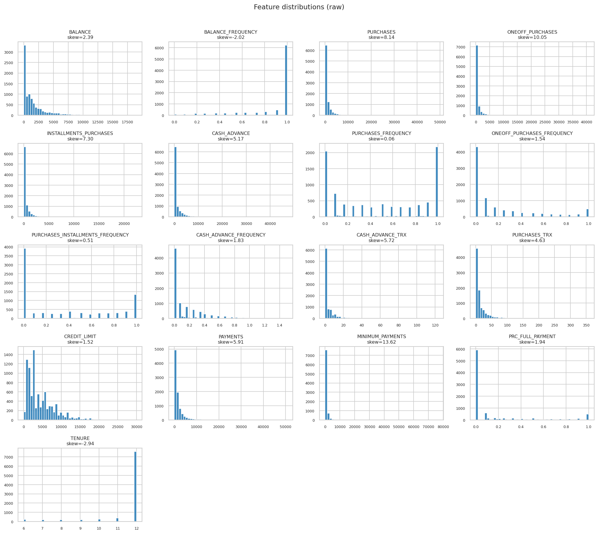

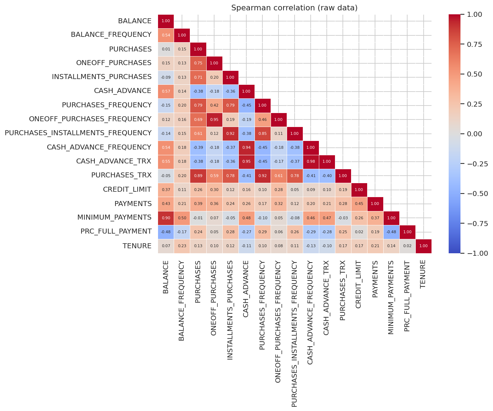

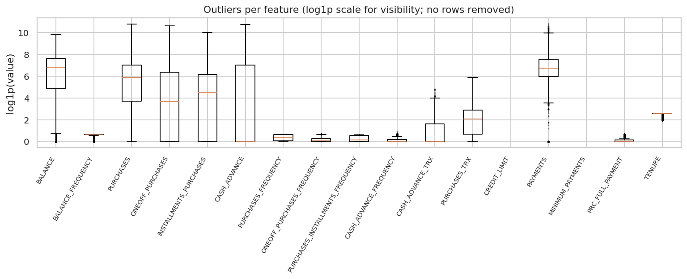

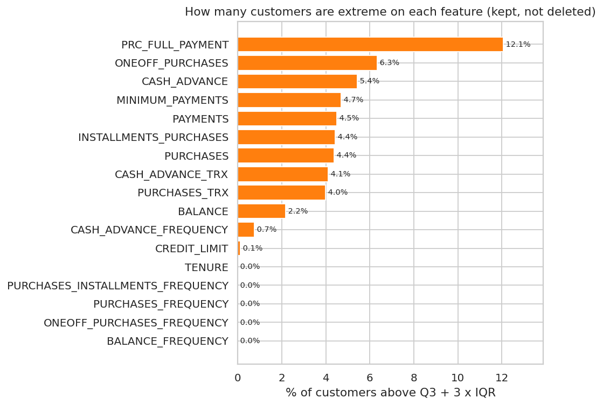

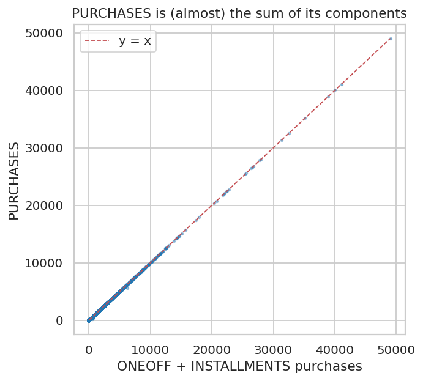

## 3. Cleaning decisions

No rows were dropped (asserted in code). Steps, in order:

1. Clip proportion fields to [0,1]: {'CASH_ADVANCE_FREQUENCY': 8}.
2. Add `MIN_PAYMENTS_MISSING` and `CREDIT_LIMIT_MISSING` flags **before** imputing, so the information is not lost (used for profiling, not clustering).
3. `CREDIT_LIMIT`: 1 value -> median (3,000).
4. `MINIMUM_PAYMENTS`: 313 values -> `median` (312.3). A zero-fill would claim "no minimum due" and a balance-scaled fill would invent a customer-specific figure; the median is the least assumption-laden. The choice is tested for sensitivity below.

**Imputation sensitivity** (same final model re-fit under each strategy; ARI vs the `median` baseline, 1 = identical segmentation):

| strategy | ari_vs_median | n_clusters |
|---|---|---|
| median | 1.000 | 4 |
| zero | 0.990 | 4 |
| balance_ratio | 0.994 | 4 |

## 4. Feature engineering

Ratios use guarded denominators (no infinities; asserted). All are computed per customer, so there is no leakage.

| Feature | Definition | Rationale |
|---|---|---|
| `BALANCE_TO_LIMIT` | `BALANCE / CREDIT_LIMIT` | Credit utilisation, comparable across limit sizes |
| `PAYMENT_TO_MINPAY_RATIO` | `PAYMENTS / max(MINIMUM_PAYMENTS, 1)` | Repayment effort relative to what was due; floor of 1 avoids absurd ratios from near-zero minimums |
| `ONEOFF_SHARE` | `ONEOFF / (ONEOFF + INSTALLMENTS)` | Purchase style, built from the components so it ignores the 20 inconsistent totals |
| `AVG_PURCHASE_TICKET` | `PURCHASES / PURCHASES_TRX` (0 if no trx) | Typical basket size |
| `AVG_CASH_ADVANCE_TICKET`, `PAYMENT_TO_BALANCE` | similar | Computed for profiling only |

`TENURE` is profiled but not clustered: 85% of customers sit at 12 and it describes the observation window more than behaviour. `CUST_ID` never enters the model; it is carried alongside and joined back by id (verified for all rows, Section 8).

**Redundancy investigation.** After log transformation several pairs are highly correlated (`outputs/preprocessing_high_correlation_pairs.csv`); cash-advance behaviour is represented by three related columns and purchases by several. An `engineered_reduced` set (dropping the two `*_TRX` counts) was tested and did not improve stability (Section 5), so the pairs were reported but not removed.

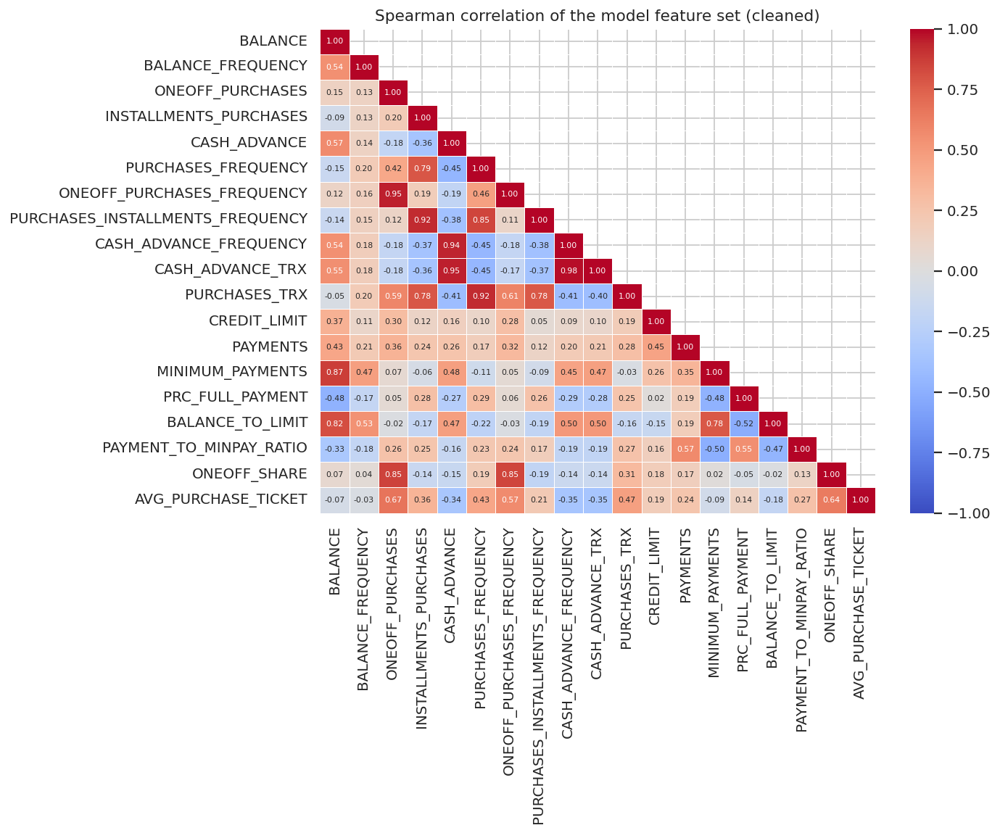

## 5. Preprocessing

Pipeline (scikit-learn `Pipeline`, pandas in/out): `SimpleImputer(median)` safety net -> `log1p` on 12 eligible columns (non-negative, unbounded, skew > 1.0) -> `robust` scaling -> `VarianceThreshold`. Proportions in [0,1] are not logged. Output validated for row count, NaN/inf, constant columns and magnitude (constant columns dropped: none found).

log1p columns: `BALANCE`, `ONEOFF_PURCHASES`, `INSTALLMENTS_PURCHASES`, `CASH_ADVANCE`, `CASH_ADVANCE_TRX`, `PURCHASES_TRX`, `CREDIT_LIMIT`, `PAYMENTS`, `MINIMUM_PAYMENTS`, `BALANCE_TO_LIMIT`, `PAYMENT_TO_MINPAY_RATIO`, `AVG_PURCHASE_TICKET`

**Comparison of 4 feature sets x 2 transforms x 2 scalers** (K-Means, k = 3..8, means over k; stability = 5-round subsample ARI):

| variant | silhouette | davies_bouldin | stability_ari | avg_min_cluster_pct | worst_min_cluster_pct |
|---|---|---|---|---|---|
| base_no_total / log1p + robust | 0.272 | 1.264 | 0.928 | 8.819 | 3.821 |
| base_no_total / log1p + standard | 0.219 | 1.513 | 0.917 | 15.866 | 10.268 |
| engineered / log1p + robust | 0.278 | 1.322 | 0.915 | 8.803 | 3.810 |
| base_with_total / log1p + robust | 0.287 | 1.245 | 0.909 | 8.801 | 3.654 |
| engineered_reduced / log1p + robust | 0.274 | 1.338 | 0.897 | 8.816 | 3.832 |
| base_with_total / log1p + standard | 0.225 | 1.510 | 0.894 | 16.061 | 9.732 |
| engineered / log1p + standard | 0.227 | 1.550 | 0.863 | 16.212 | 7.732 |
| base_no_total / raw + standard | 0.226 | 1.441 | 0.833 | 4.508 | 0.268 |
| base_with_total / raw + standard | 0.230 | 1.456 | 0.815 | 3.462 | 0.257 |
| engineered_reduced / log1p + standard | 0.226 | 1.571 | 0.801 | 14.827 | 7.531 |
| engineered / raw + standard | 0.185 | 1.613 | 0.757 | 7.086 | 0.089 |
| engineered_reduced / raw + standard | 0.191 | 1.595 | 0.734 | 6.114 | 0.089 |
| base_no_total / raw + robust | 0.345 | 1.151 | 0.731 | 0.318 | 0.078 |
| engineered_reduced / raw + robust | 0.511 | 0.841 | 0.668 | 0.022 | 0.022 |
| base_with_total / raw + robust | 0.357 | 1.106 | 0.638 | 0.322 | 0.078 |
| engineered / raw + robust | 0.497 | 0.839 | 0.499 | 0.022 | 0.022 |

Findings: (1) `log1p` variants dominate on stability. (2) Without `log1p`, 16 of 48 runs isolate clusters smaller than 0.1% of customers (smallest 0.022%), and the *highest* silhouettes in the table (0.93) come from exactly those runs: the metric is rewarding the isolation of a handful of outliers, not real structure. (3) `RobustScaler` beats `StandardScaler` on silhouette and Davies-Bouldin; `StandardScaler` yields more balanced but more overlapping clusters. (4) The feature-set differences are smaller than the bootstrap standard deviation, i.e. a **statistical tie**; `engineered` was chosen because it adds utilisation and repayment-versus-minimum signals relevant to the brief. Silhouette is also not strictly comparable across different feature spaces, which is why stability and cluster size are weighted heavily.


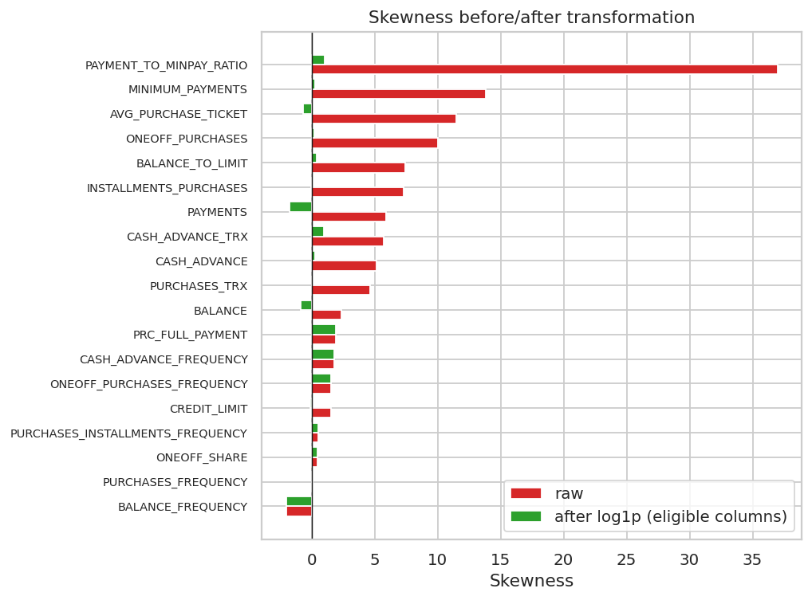


`log1p` removes most of the skew but leaves the spike at zero; robust scaling only rescales (the shape is unchanged). A few columns are slightly over-corrected to the left (e.g. `PAYMENTS`, 5.9 to -1.8).

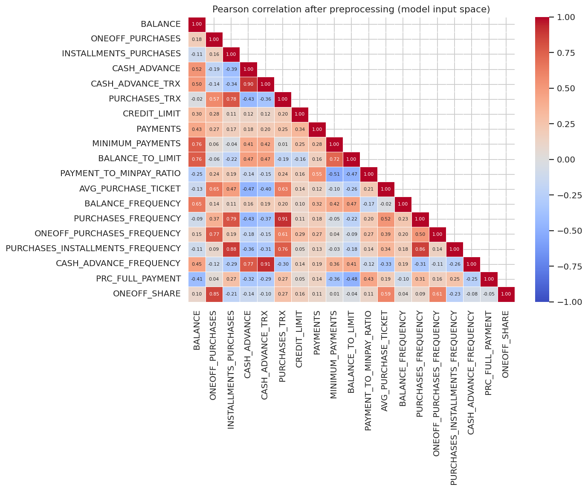

## 6. Clustering experiments

93 candidate models were fitted on the same matrix with fixed seeds: K-Means and MiniBatch K-Means (k=2..10), Agglomerative (ward and average linkage, k=2..10), Gaussian Mixture (full/tied/diag/spherical covariance, k=2..10), DBSCAN (eps from k-distance quantiles x min_samples 10/20/40) and HDBSCAN (min_cluster_size 50/100/200 x min_samples 10/30). MiniBatch K-Means is included as a scalability baseline, not because 9k rows need it. Models failing any hard constraint are not eligible regardless of score (k in [3,8], smallest cluster >= 2%, noise <= 20%); 42 of 93 are eligible.

| algorithm | configs_tried | eligible | best_eligible_model | silhouette of best |
|---|---|---|---|---|
| agglomerative | 18 | 6 | agglomerative[linkage=ward,n_clusters=3] | 0.361 |
| dbscan | 15 | 0 | none eligible |  |
| gmm | 36 | 24 | gmm[covariance_type=tied,n_clusters=3] | 0.405 |
| hdbscan | 6 | 0 | none eligible |  |
| kmeans | 9 | 6 | kmeans[n_clusters=3] | 0.396 |
| minibatch_kmeans | 9 | 6 | minibatch_kmeans[n_clusters=3] | 0.394 |

What the results show:

- **Average-linkage agglomerative** reaches silhouettes up to 0.38 and Davies-Bouldin as low as 0.53, but its smallest cluster is 1 customer(s): it peels off isolated outliers and leaves one giant cluster. Not a segmentation.
- **DBSCAN**: 5 of 15 settings collapse to a single cluster; in the 10 that find 2+ clusters the largest cluster still holds 89-99% of customers (all 15 settings are ineligible).
- **HDBSCAN**: noise ranges from 10% to 52% of customers; the 1 setting(s) within the 20% noise limit find only 2 clusters, below the minimum k of 3. Behaviour here looks like a continuum rather than well-separated dense groups.
- **Full-covariance GMM** has silhouettes of only 0.03-0.14: components overlap heavily and chase the heavy tails. Tied and spherical covariance are competitive.
- Only centroid-style models (K-Means, MiniBatch K-Means, Ward, spherical/tied/diag GMM) are both eligible and well-scoring. Among eligible finalists the most stable is `gmm[covariance_type=spherical,n_clusters=4]` (ARI 0.995); MiniBatch K-Means and several GMM settings show high variance across subsamples (see Section 7).


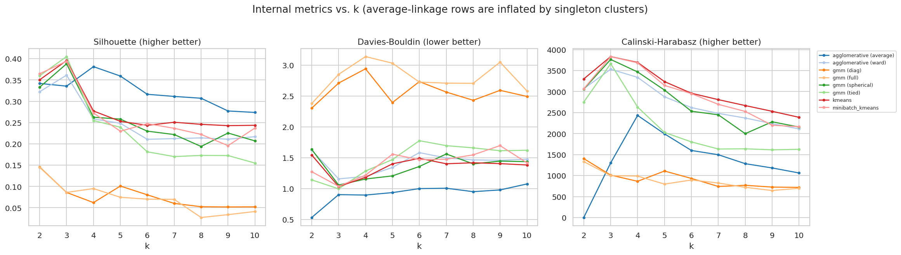

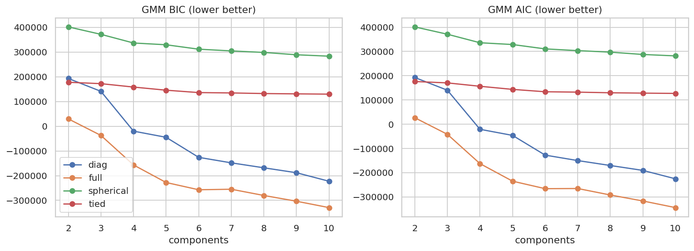

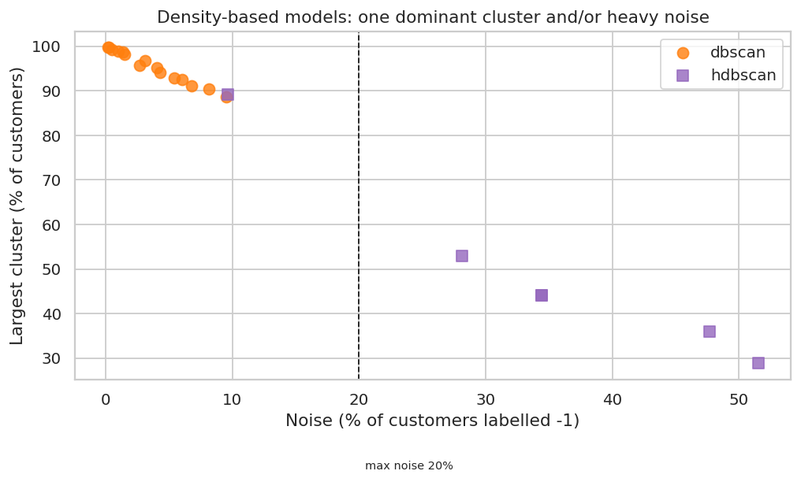

## 7. Evaluation and model selection

Finalists (top 3 eligible per algorithm, plus the best ineligible model where an algorithm has none, so rejections are visible) were stress-tested with 10 rounds of subsampling (80% of rows, two independent refits per round, ARI on the shared rows). Eligible models with stability >= 0.6 are ranked by the equal-weight mean rank of silhouette, Davies-Bouldin, Calinski-Harabasz and stability.

| model | k | noise % | min cluster % | silh. | DB | CH | stability | mean rank | status |
|---|---|---|---|---|---|---|---|---|---|
| kmeans[n_clusters=3] | 3 | 0.00 | 13.74 | 0.40 | 1.03 | 3833.03 | 0.99 +/- 0.00 | 1.25 | ranked |
| minibatch_kmeans[n_clusters=3] | 3 | 0.00 | 13.90 | 0.39 | 1.04 | 3832.28 | 0.71 +/- 0.32 | 4.00 | ranked |
| gmm[covariance_type=spherical,n_clusters=3] | 3 | 0.00 | 13.45 | 0.39 | 1.06 | 3764.65 | 0.77 +/- 0.28 | 4.25 | ranked |
| kmeans[n_clusters=4] | 4 | 0.00 | 13.33 | 0.28 | 1.18 | 3694.67 | 0.99 +/- 0.00 | 4.50 | **SELECTED** |
| gmm[covariance_type=spherical,n_clusters=4] | 4 | 0.00 | 13.15 | 0.26 | 1.16 | 3467.75 | 1.00 +/- 0.00 | 4.75 | ranked |
| minibatch_kmeans[n_clusters=4] | 4 | 0.00 | 13.20 | 0.27 | 1.22 | 3683.61 | 0.91 +/- 0.08 | 5.75 | ranked |
| agglomerative[linkage=ward,n_clusters=3] | 3 | 0.00 | 13.78 | 0.36 | 1.16 | 3531.77 | 0.76 +/- 0.08 | 6.00 | ranked |
| agglomerative[linkage=ward,n_clusters=4] | 4 | 0.00 | 13.78 | 0.26 | 1.20 | 3338.85 | 0.80 +/- 0.07 | 7.50 | ranked |
| kmeans[n_clusters=5] | 5 | 0.00 | 12.85 | 0.25 | 1.40 | 3237.34 | 0.88 +/- 0.13 | 8.25 | ranked |
| agglomerative[linkage=ward,n_clusters=5] | 5 | 0.00 | 5.02 | 0.25 | 1.34 | 2876.17 | 0.82 +/- 0.05 | 9.00 | ranked |
| minibatch_kmeans[n_clusters=6] | 6 | 0.00 | 4.26 | 0.25 | 1.47 | 2950.90 | 0.64 +/- 0.09 | 10.75 | ranked |
| gmm[covariance_type=tied,n_clusters=3] | 3 | 0.00 | 11.13 | 0.41 | 1.00 | 3664.11 | 0.55 +/- 0.29 |  | rejected: stability ARI 0.55 < 0.6 |
| dbscan[eps=2.09,min_samples=40] | 2 | 4.31 | 1.52 | 0.44 | 0.67 | 647.57 | 0.95 +/- 0.01 |  | rejected: k=2 outside [3,8]; smallest cluster 1.52% < 2% |
| hdbscan[min_cluster_size=100,min_samples=30] | 2 | 9.65 | 1.20 | 0.47 | 0.62 | 568.68 | 0.79 +/- 0.30 |  | rejected: k=2 outside [3,8]; smallest cluster 1.2% < 2% |

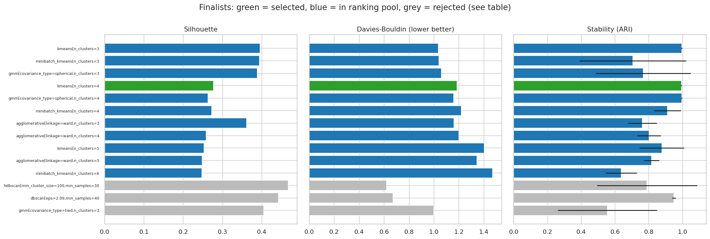

**Decision.** `kmeans[n_clusters=3]` has the best composite rank, but the composite is biased toward small k (silhouette and CH both fall as k grows). Composite rank preferred K-Means k=3, but its largest segment (71% of customers) merges cash-advance-only borrowers with active purchasers. k=4 splits exactly that segment, keeps the other two segments almost unchanged, sits at the inertia elbow, and is just as stable (ARI 0.99). `kmeans[n_clusters=4]` remains eligible and stable. Trade-off accepted: silhouette drops from 0.396 to 0.277 and CH from 3,833 to 3,695. A reader who prefers the more parsimonious k=3 can switch `selection.final_model_id` in `configs/config.yaml` and rerun.

K-Means by k on the selected preprocessing (5-round stability from the preprocessing study):

| k | silhouette | davies_bouldin | min_cluster_pct | stability_ari_mean | stability_ari_std |
|---|---|---|---|---|---|
| 3.000 | 0.396 | 1.035 | 13.743 | 0.996 | 0.002 |
| 4.000 | 0.277 | 1.184 | 13.330 | 0.995 | 0.001 |
| 5.000 | 0.253 | 1.403 | 12.849 | 0.920 | 0.099 |
| 6.000 | 0.244 | 1.491 | 4.581 | 0.861 | 0.112 |
| 7.000 | 0.251 | 1.403 | 4.503 | 0.805 | 0.112 |
| 8.000 | 0.246 | 1.419 | 3.810 | 0.917 | 0.077 |

## 8. Customer profiles

Profiles use the **cleaned original-scale values** (not the scaled features). Names come from a deterministic rule on segment medians (`profiling.naming` in the config) and describe observed behaviour only.

**Medians by segment:**

| segment | pct customers | balance (med) | purchases (med) | oneoff purchases (med) | installments purchases (med) | cash advance (med) | purchases frequency (med) | cash advance frequency (med) | credit limit (med) | payments (med) | balance to limit (med) |
|---|---|---|---|---|---|---|---|---|---|---|---|
| Cash-Advance Borrowers | 21.88 | 1,753.92 | 0.00 | 0.00 | 0.00 | 1,365.53 | 0.00 | 0.25 | 3,000.00 | 820.26 | 0.70 |
| Low-Activity Light Users | 13.33 | 23.25 | 143.00 | 0.00 | 0.00 | 0.00 | 0.17 | 0.00 | 2,700.00 | 325.97 | 0.01 |
| Frequent Full-Payers | 14.40 | 90.08 | 915.64 | 95.14 | 456.00 | 0.00 | 0.92 | 0.00 | 4,000.00 | 1,099.57 | 0.02 |
| Active Balance-Carriers | 50.39 | 1,179.96 | 677.00 | 290.00 | 238.19 | 0.00 | 0.75 | 0.00 | 3,500.00 | 969.14 | 0.41 |

**Observed usage and repayment (% of segment):**

| segment | % use cash advance | % no purchases | % full payers ge 50 | % never full payment | % payments below min due | % balance above limit | PAYMENT TO MINPAY RATIO median | TENURE mean |
|---|---|---|---|---|---|---|---|---|
| Cash-Advance Borrowers | 99.9 | 90.6 | 0.2 | 83.4 | 44.1 | 1.5 | 1.1 | 11.4 |
| Low-Activity Light Users | 29.3 | 20.8 | 8.5 | 67.7 | 26.7 | 0.0 | 3.2 | 11.3 |
| Frequent Full-Payers | 8.6 | 1.8 | 90.9 | 0.0 | 1.9 | 0.0 | 7.2 | 11.5 |
| Active Balance-Carriers | 42.2 | 0.0 | 0.0 | 76.8 | 31.8 | 4.4 | 1.6 | 11.6 |

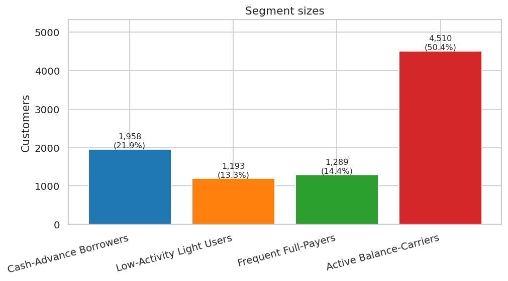


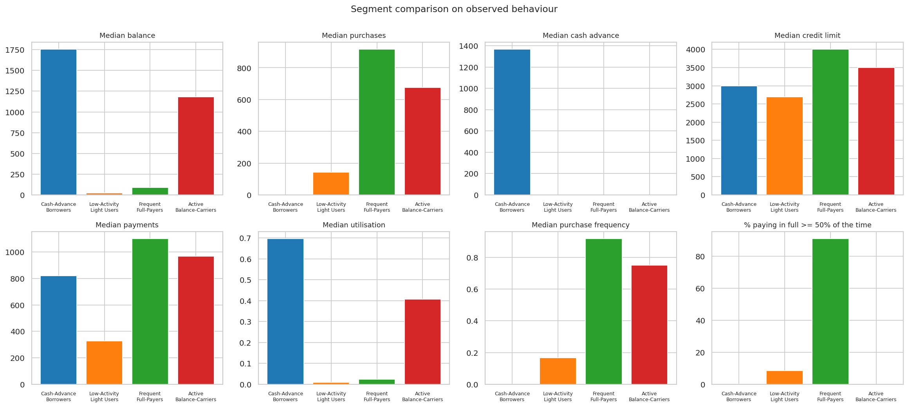


PCA note: PC1+PC2 capture 60.9% of variance (80% needs 4 components, 90% needs 7), so the 2-D picture shows overlap that is not present in the full space. It is an illustration, not evidence of cluster quality; clustering used all features.

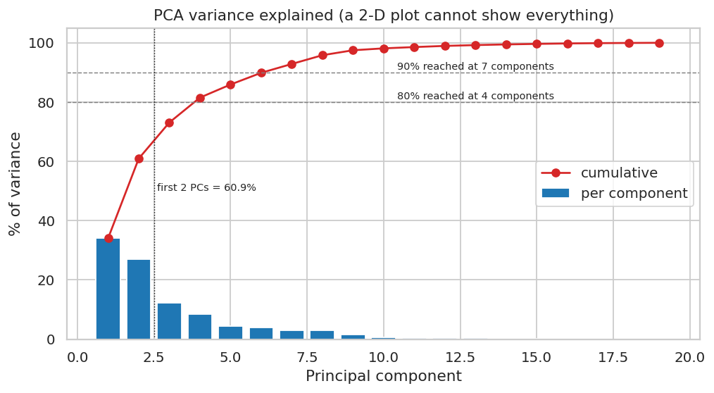

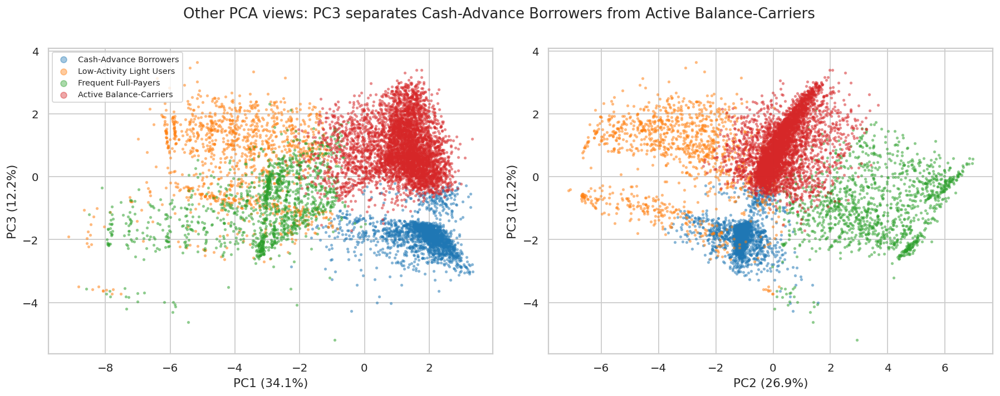

In the PC1/PC3 view, Cash-Advance Borrowers separate cleanly from Active Balance-Carriers along PC3; Low-Activity Light Users and Frequent Full-Payers still overlap in these 2-D views.

### Segments: observed behaviour, assumptions, and suggested actions

> **Observed** = measured in this dataset. **Assumption** = a hypothesis about profit or risk that the data cannot confirm (no revenue, interest, fee, or delinquency fields exist). Actions are suggestions to test, ideally with A/B experiments.

#### Cash-Advance Borrowers (21.9%)

- **Observed:** Cash-Advance Borrowers (21.9% of customers): median balance 1,754, median purchases 0 (purchase frequency 0.00), median cash advance 1,366, median credit limit 3,000, median payments 820, 0% pay >=50% of the time in full.
- **Assumption (unverified):** Likely a higher-risk and higher-fee-income group, since cash advances usually carry fees and higher rates. This dataset has no fee, interest or delinquency fields, so this is NOT verified.
- **Suggested action:** Offer a lower-rate balance-transfer or personal-loan product; nudge toward everyday purchases with card rewards; monitor utilisation for early-warning review (do not auto-restrict on this label alone).

#### Low-Activity Light Users (13.3%)

- **Observed:** Low-Activity Light Users (13.3% of customers): median balance 23, median purchases 143 (purchase frequency 0.17), median cash advance 0, median credit limit 2,700, median payments 326, 8% pay >=50% of the time in full.
- **Assumption (unverified):** Probably low revenue today and a possible attrition risk, but also the largest headroom for activation. Unverified.
- **Suggested action:** Activation campaign: first-purchase bonuses, spend-threshold rewards, merchant partnerships; review whether the card is still the right product (annual-fee-free tier) before spending on acquisition-style offers.

#### Frequent Full-Payers (14.4%)

- **Observed:** Frequent Full-Payers (14.4% of customers): median balance 90, median purchases 916 (purchase frequency 0.92), median cash advance 0, median credit limit 4,000, median payments 1,100, 91% pay >=50% of the time in full.
- **Assumption (unverified):** Likely low interest income but high interchange (swipe-fee) value and low credit risk. Unverified - no revenue data.
- **Suggested action:** Retention and loyalty: premium rewards tier, limit increases, installment-plan promotions for big-ticket items; avoid interest-based offers that do not match their behaviour.

#### Active Balance-Carriers (50.4%)

- **Observed:** Active Balance-Carriers (50.4% of customers): median balance 1,180, median purchases 677 (purchase frequency 0.75), median cash advance 0, median credit limit 3,500, median payments 969, 0% pay >=50% of the time in full.
- **Assumption (unverified):** Likely the main interest-income group, with moderate risk that depends on utilisation and repayment trends. Unverified.
- **Suggested action:** Cross-sell installment plans and balance-management tools; reward on-time payments; watch the sub-group with payments below the minimum due for hardship outreach.

## 9. Robustness and integrity checks

- **ID/label alignment:** 8,950 customers; 0 unassigned; 0 label mismatches; same id set as the raw file: True; row order preserved: True.
- **Refit consistency:** re-predicting the fitted model on the transformed data reproduces the stored labels: True.
- **Feature-set agreement** (ARI between the final K-Means and K-Means with the same k on another feature set): `base_no_total` 0.64, `base_with_total` 0.80, `engineered_reduced` 0.96.
- **Raw data unchanged:** True (SHA-256 `f3d1e93ca09cea44...`).

## 10. Limitations

- Single snapshot of up to 12 months; no time dimension, so behavioural change and churn cannot be assessed.
- No profitability, interest, fee, delinquency or demographic data: risk and value statements are assumptions.
- Internal validity indices (silhouette, DB, CH) favour compact, convex clusters and small k; credit-card behaviour is a continuum, so segments are *useful partitions*, not natural kinds. Silhouette values around 0.25-0.30 indicate moderate overlap.
- Silhouette is not strictly comparable across different feature spaces; the preprocessing study therefore leans on stability and cluster size.
- Stability was estimated with a small number of rounds (5 for the preprocessing study, 10 for finalists); some solutions are bimodal (high mean, large std).
- The k=4 choice over the composite-rank winner k=3 is a documented judgement call made after seeing the profiles; the feature-set choice was a statistical tie on metrics. Re-running K-Means with the same k on `base_no_total` agrees with the final labels only at ARI 0.64, so the feature-set choice changes a meaningful share of individual assignments even though headline metrics tie; the segment *archetypes* should be trusted more than any single customer's label.
- Segment names use thresholds tuned on this dataset and should be re-reviewed on new data. New customers can be scored (`segmentation.scoring`, dashboard tab "Test the model"), but a score is the *closest* of four centroids, not a probability, and inputs far outside the training range are extrapolations.

## 11. Reproducibility

```bash
pip install -r requirements-dev.txt        # runtime + pytest (requirements.txt = runtime only)
python run_pipeline.py                   # ~12 min on one CPU core; add --reuse-prep-comparison to skip a 3.5 min step
python -m segmentation.reporting          # regenerates this report (run with PYTHONPATH=src)
streamlit run app/streamlit_app.py
pytest
```

Scoring check: scoring all raw customers with the saved bundle reproduces the pipeline assignments exactly (automated test). Artifacts: `outputs/model_comparison.csv`, `outputs/customer_assignments.csv`, `outputs/segment_summary.csv`, `outputs/segment_profile_index.csv`, `outputs/clustering_grid_all_models.csv`, `outputs/preprocessing_comparison.csv`, `outputs/customers_with_segments.csv`, `figures/*.png`, `models/final_model.joblib`.
